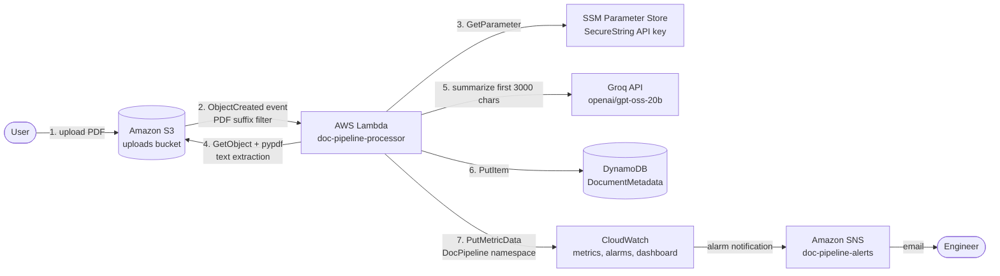
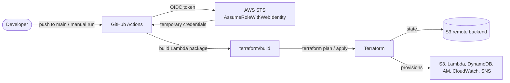

# AWS Document Pipeline (Serverless AI on AWS)

An event-driven, serverless pipeline that processes PDF uploads. When a PDF is uploaded to Amazon S3, an AWS Lambda function extracts its text with `pypdf`, requests an AI summary from the Groq API, stores the processing result in Amazon DynamoDB, and publishes custom metrics to Amazon CloudWatch. CloudWatch alarms can notify an engineer through Amazon SNS.

Application infrastructure is defined with Terraform. GitHub Actions is configured to authenticate to AWS using GitHub OIDC, so long-lived AWS access keys do not need to be stored in GitHub.

**Stack:** Amazon S3 · AWS Lambda (Python 3.12) · Amazon DynamoDB · AWS Systems Manager Parameter Store · Amazon CloudWatch · Amazon SNS · AWS IAM · Terraform · GitHub Actions · Groq API (`openai/gpt-oss-20b`)

> **Implementation scope:** This version uses S3 event notifications to invoke Lambda directly. It does not currently implement API Gateway or AWS Step Functions. Those are possible future enhancements, not part of the current deployed architecture.

---

## Architecture

### Runtime flow



### CI/CD flow



The Terraform remote-state bucket must exist before `terraform init`. The SSM parameter containing the Groq API key is also created before deployment. The first Terraform deployment must be performed locally if it is responsible for creating the GitHub OIDC provider and deployment role that later GitHub Actions runs assume.

---

## How it works

1. A PDF is uploaded to the configured S3 bucket. The bucket notification is filtered for the `.pdf` suffix.
2. S3 invokes the `doc-pipeline-processor` Lambda function.
3. Lambda downloads the object and uses `pypdf` to extract text from its pages.
4. If no text is extracted, the handler logs the condition and skips the document; no DynamoDB record is written for that file.
5. Lambda retrieves the Groq API key from SSM Parameter Store. The parameter is a `SecureString`; the handler caches the value in a warm Lambda execution environment.
6. The first 3,000 characters of extracted text are sent to Groq with a prompt requesting a concise, three-sentence summary. The application does not enforce or validate the exact number of sentences returned.
7. Lambda writes a record to the `DocumentMetadata` DynamoDB table. The record includes `documentId` (UUID), `bucket`, `key`, `summary`, `textLength`, and `processedAt`.
8. Lambda publishes custom metrics in the `DocPipeline` CloudWatch namespace, including `DocumentsProcessed` and `ProcessingDuration`. When processing raises an exception, it publishes `ProcessingErrors` and re-raises the exception.
9. CloudWatch alarms monitor the Lambda error metric and the custom processing-error metric. Alarm notifications are sent through the `doc-pipeline-alerts` SNS topic to its subscribed email address.

---

## Features

- **Infrastructure as Code:** The application S3 bucket, Lambda function, DynamoDB table, IAM resources, CloudWatch dashboard and alarms, SNS topic, and GitHub OIDC resources are defined in Terraform. The remote-state bucket and SSM API-key parameter are prerequisites created separately.
- **Secure API-key storage:** The Groq API key is stored in SSM Parameter Store as a `SecureString`, rather than being hard-coded in the Lambda source.
- **Private document storage:** The application S3 bucket blocks public access. Access is granted through IAM permissions.
- **Restricted Lambda permissions:** The Lambda execution role is scoped to the application bucket, DynamoDB table, required SSM parameter path, CloudWatch Logs, and the `DocPipeline` custom-metric namespace, as defined in the IAM policy.
- **Monitoring and alerting:** CloudWatch includes custom application metrics, a dashboard, and two alarms:
  - `doc-pipeline-lambda-errors` monitors the AWS/Lambda `Errors` metric and is configured to notify SNS on ALARM and OK state transitions.
  - `doc-pipeline-processing-errors` monitors the custom `ProcessingErrors` metric and is configured to notify SNS on ALARM.
- **OIDC-based CI/CD:** GitHub Actions obtains temporary AWS credentials through GitHub OIDC rather than using long-lived AWS access keys. The trust policy is intended to restrict assumption to the specified GitHub repository.
- **Cost-conscious configuration:** DynamoDB uses on-demand billing, and the Lambda is configured with 512 MB memory and a 60-second timeout. Actual costs depend on region, request volume, storage, CloudWatch usage, account eligibility, and Groq API usage.

> **Deployment-role security note:** The GitHub Actions role in the current Terraform configuration has broader permissions than the Lambda execution role (including `PowerUserAccess` and IAM-related permissions). Restrict this deployment role further before treating the complete deployment setup as least-privilege.

---

## Repository structure

```text
.
├── SRC/
│   ├── lambda_function.py      # Lambda handler
│   └── requirements.txt        # Python dependencies (pypdf)
├── terraform/
│   ├── main.tf                 # Provider, S3 backend, S3 bucket, DynamoDB table
│   ├── lambda.tf               # Lambda, S3 invoke permission, bucket notification
│   ├── IAM.tf                  # Lambda execution role and policy
│   ├── ssm.tf                  # SSM API-key parameter data/configuration
│   ├── observability.tf        # SNS topic, alarms, dashboard
│   ├── github_oidc.tf          # GitHub OIDC provider and deployment role
│   ├── variable.tf             # Region and bucket variables
│   └── outputs.tf
└── .github/
    └── workflows/
        └── deploy.yml          # GitHub Actions workflow
```

---

## Prerequisites

- An AWS account and AWS CLI configured locally.
- Terraform (the GitHub Actions workflow specifies Terraform 1.9.5).
- Python 3.12.
- A Groq API key from [Groq Console](https://console.groq.com/).
- A globally unique S3 bucket name for application uploads.
- A separate S3 bucket for Terraform remote state, created before `terraform init`.
- An email address that can confirm the SNS subscription.
- Permission to create the required AWS resources.

The SSM parameter and Terraform state bucket are external prerequisites; they are not created by the application Terraform configuration described here.

---

## Deployment

### 1. Clone the repository

```bash
git clone https://github.com/sindhujaVispute/AWS-document-pipeline.git
cd AWS-document-pipeline
```

### 2. Create the Groq API-key parameter

Use the same AWS region configured for the Terraform provider and Lambda:

```bash
aws ssm put-parameter \
  --name "/doc-pipeline/ai-api-key" \
  --value "YOUR_GROQ_API_KEY" \
  --type SecureString \
  --region us-east-1
```

Do not commit the API key or paste it into source files. Avoid putting secrets in shell history; use a safer secret-entry method where practical.

### 3. Configure Terraform and GitHub Actions

Review and update the configuration values:

- `bucket_name` in `terraform/variable.tf` (the application bucket name must be globally unique).
- The S3 backend bucket in `terraform/main.tf`.
- The AWS region in the Terraform provider and workflow.
- The alert email address in `terraform/observability.tf`.
- The GitHub repository owner/name in `terraform/github_oidc.tf`.
- The role ARN used by `.github/workflows/deploy.yml`.

Ensure the remote-state bucket already exists and that its region and backend settings are correct.

### 4. Build the Lambda deployment package

Run these commands from the repository root:

```bash
rm -rf terraform/build
mkdir -p terraform/build
python -m pip install -r SRC/requirements.txt -t terraform/build
cp SRC/lambda_function.py terraform/build/
```

### 5. Initialize and deploy Terraform

```bash
cd terraform
terraform init
terraform validate
terraform plan
terraform apply
```

Review the plan before approving the apply. The first local deployment may be needed to create the GitHub OIDC provider and role used by later GitHub Actions deployments.

### 6. Confirm the SNS subscription

Check the configured email inbox and confirm the subscription request from Amazon SNS. Notifications will not be delivered to an email address until the subscription is confirmed.

---

## Testing

### End-to-end test

Upload a text-based PDF to the configured bucket:

```bash
aws s3 cp sample.pdf s3://<your-bucket-name>/sample.pdf
```

After the S3 event invokes Lambda, verify:

- **DynamoDB:** Open the `DocumentMetadata` table and inspect the new item.
- **CloudWatch Logs:** Open `/aws/lambda/doc-pipeline-processor` and inspect the invocation logs.
- **CloudWatch Dashboard:** Open `doc-pipeline-dashboard` and inspect invocation, error, duration, and custom metric graphs.
- **SNS:** If an alarm transitions into a configured notification state, verify that the subscribed email receives the notification.

A successful upload command only confirms that the file reached S3. It does not by itself prove that downstream processing succeeded; verify the Lambda execution and DynamoDB item.

### CI/CD workflow status and repository checks

The workflow file in the supplied repository archive needs corrections before it can reliably build from the repository's uppercase `SRC/` directory:

- Change every `src/` path to `SRC/` in `.github/workflows/deploy.yml`; GitHub-hosted Linux runners use case-sensitive paths.
- The current test step treats the absence of `tests/test_lambda.py` as a successful no-op. Add and maintain the test file, then make the test command fail if the file or tests are missing.
- Do not describe CI tests as blocking deployment until the workflow has been updated and a successful GitHub Actions run confirms that behavior.

Once tests exist, the intended test command is:

```bash
python -m pip install -r SRC/requirements.txt pytest
pytest -q tests/
```

---

## Current limitations

- **Text-based PDFs only:** `pypdf` extracts embedded PDF text but does not perform OCR. Scanned/image-only PDFs may produce no extractable text and are skipped.
- **Input truncation:** Only the first 3,000 characters of extracted text are sent to the Groq API.
- **Summary length is prompt-based:** The prompt requests three concise sentences, but the returned summary is not validated to contain exactly three sentences.
- **S3 object-key decoding:** S3 event object keys can be URL-encoded. The Lambda handler in the supplied repository archive reads the event key directly; add `unquote_plus` decoding before claiming support for keys containing spaces or special characters.
- **No API Gateway or Step Functions:** Upload processing is started by an S3 event notification. HTTP API endpoints and Step Functions workflow orchestration are not implemented in this version.
- **External AI dependency:** Summary generation requires access to the Groq API and a valid API key in SSM Parameter Store.

---

## Cost and cleanup

The architecture uses managed, usage-based services, but it is not guaranteed to be free. Charges may arise from Lambda invocations and duration, S3 storage and requests, DynamoDB usage, SSM requests, CloudWatch logs/metrics/alarms, SNS notifications, Terraform state storage, and the external Groq API.

To avoid ongoing AWS charges when the project is not in use:

1. Back up any documents or results you want to keep.
2. Use Terraform to destroy the application resources when they are no longer needed.
3. Check for remaining S3 objects and object versions, CloudWatch log groups, SNS resources, and other resources not removed by Terraform.
4. Keep the Terraform remote-state bucket if you need it for future Terraform operations; remove it only when you are certain the state is no longer needed.
5. Check AWS Billing and Cost Explorer after cleanup. Billing data can take time to update.

Do not delete the Terraform state bucket before completing the Terraform destroy operation.

---

## Roadmap

- [ ] Decode S3 event object keys with `unquote_plus`.
- [ ] Add automated unit tests for the Lambda handler and require them to pass before deployment.
- [ ] Restrict the GitHub Actions deployment role to the minimum permissions needed.
- [ ] Add chunked or map-reduce summarization for long PDFs.
- [ ] Add OCR for scanned documents using Amazon Textract.
- [ ] Add a dead-letter queue and an explicit retry strategy for failed documents.
- [ ] Add a frontend for uploading documents and viewing summaries.
- [ ] Add integration tests against real AWS resources.
- [ ] Optional: Add API Gateway for HTTP-based upload/result APIs.
- [ ] Optional: Add AWS Step Functions to orchestrate multi-stage processing.

---

## Author

**Sindhuja Vispute** · [@sindhujaVispute](https://github.com/sindhujaVispute)
